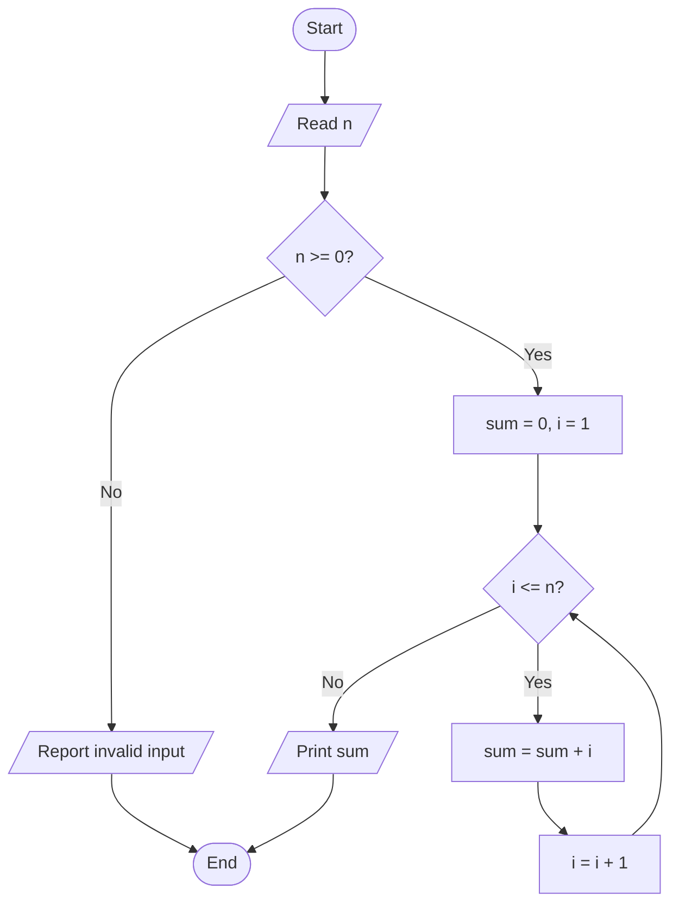

# Session 01 — Flowcharts, Pseudocode, and C++ Setup

**Course:** [Apna College — Complete C++ DSA](https://www.youtube.com/playlist?list=PLfqMhTWNBTe137I_EPQd34TsgV6IO55pt) · **Lesson:** [Flowchart &amp; Pseudocode + Installation](https://www.youtube.com/watch?v=VTLCoHnyACE)

**Next:** [02 — Variables, Data Types, and Operators](./02-Variables-Data-Types-and-Operators.md)

* [ ] Start here: how to use these notes

These ten files rebuild the foundations from zero and then connect them to interview reasoning. They are original explanations aligned to the first ten lesson topics, with additional safeguards and practice. **Core** means the session's main syllabus; **Interview extension** means useful depth added to it. Completing these sessions builds a foundation for MAANG preparation; full interview readiness also needs later topics and independent problem solving.

**First pass:** read the explanation, reproduce the dry run on paper, write the code from memory, then attempt the questions at the end. Use the video when another explanation would help.

**Reverse revision:** go straight to **Revision questions** at the bottom. Answer aloud or on paper before opening the answer key. If you miss a question, follow its section reference, repair the gap, and answer it again without looking. Re-reading something familiar is weaker evidence than producing it yourself.

Use this score for each question: **0** = cannot explain, **1** = recognise but need help, **2** = explain and solve independently. Revisit 0s first. Suggested review intervals are the next day, several days later, and a week later; adjust to your recall. These are study suggestions, not recorded progress.

<a id="course-map"></a>

## Course map and topic checklist

| Session | File                                                                                              | Be able to do this before marking it complete                              |
| ------- | ------------------------------------------------------------------------------------------------- | -------------------------------------------------------------------------- |
| 01      | This file                                                                                         | Turn a statement into precise steps, trace state, compile and run          |
| 02      | [Variables, Data Types, and Operators](./02-Variables-Data-Types-and-Operators.md)                 | Predict types, division, casts, and overflow risks                         |
| 03      | [Conditionals and Loops](./03-Conditional-Statements-and-Loops.md)                                 | Choose branches, prove loop progress, check primes safely                  |
| 04      | [Patterns and Nested Loops](./04-Patterns-and-Nested-Loops.md)                                     | Derive row formulas and reproduce patterns without memorising              |
| 05      | [Functions and Problem Decomposition](./05-Functions-and-Problem-Decomposition.md)                 | Explain calls, value/reference parameters, factorial, digits, combinations |
| 06      | [Binary Number System and Conversions](./06-Binary-Number-System-and-Conversions.md)               | Convert both ways and interpret fixed-width signed bits                    |
| 07      | [Bitwise Operators, Scope, and Type Modifiers](./07-Bitwise-Operators-Scope-and-Type-Modifiers.md) | Use masks, distinguish logical/bitwise operations, handle shift limits     |
| 08      | [Arrays, Linear Search, and Two Pointers](./08-Arrays-Linear-Search-and-Two-Pointers.md)           | Explain layout and decay, search, reverse, handle empty inputs             |
| 09      | [Vectors and Single Number](./09-Vectors-and-Single-Number.md)                                     | Use size/capacity correctly, explain amortisation, solve XOR cancellation  |
| 10      | [Subarrays and Kadane&#39;s Algorithm](./10-Subarrays-and-Kadanes-Algorithm.md)                    | Derive the recurrence, prove it, return sum and indices                    |

Keep your own checkboxes: [ ] 01 [ ] 02 [ ] 03 [ ] 04 [ ] 05 [ ] 06 [ ] 07 [ ] 08 [ ] 09 [ ] 10. Mark only after a closed-book attempt.

The sequence deliberately introduces a little complexity analysis early. **Time complexity** describes how work grows with input size. **Auxiliary space** is extra working memory beyond the input, with output memory stated separately. We use the usual model where an operation on a fixed-width integer costs constant time. Huge arbitrary-precision integers need a different cost model.

<a id="concepts"></a>

## 1. Problem solving begins before syntax

A **data structure** organises data so operations are convenient: for example, an array stores a sequence of values. An **algorithm** is a precise procedure for solving a specified task. A program is an implementation of that procedure in a language such as C++.

For each problem, establish a **contract**:

1. What is the input, and which values are allowed?
2. What exact output is required?
3. What happens at boundaries: zero, negatives, empty input, duplicates?
4. What limits must the implementation respect?

For “sum the first `n` natural numbers”, choose `n >= 0`, include numbers `1` through `n`, and define `n = 0` as an empty sum equal to zero. Negative input is outside this contract; silently returning zero for it would hide a mistake.

**Correctness** means satisfying the contract for every allowed input. Passing one example is evidence, not a proof.

## 2. Flowcharts: make control visible

A flowchart represents the order of actions using shapes and arrows.

| Shape              | Meaning                         | Example                  |
| ------------------ | ------------------------------- | ------------------------ |
| Oval / rounded box | Start or end                    | Start, Stop              |
| Parallelogram      | Input or output                 | Read `n`, print result |
| Rectangle          | Computation or assignment       | `sum = sum + i`        |
| Diamond            | Decision with labelled outcomes | `i <= n?`              |
| Arrow              | Next action                     | Return to the condition  |

Most introductory algorithms combine **sequence** (one action after another), **selection** (choose a branch), and **iteration** (repeat).



Notice that the **No** arrow from the loop condition reaches output. An unlabelled or missing exit path makes the procedure ambiguous.

## 3. Pseudocode: exact logic without C++ punctuation

Pseudocode is structured text for an algorithm. It has no universal compiler or mandatory syntax. Consistent indentation and precise operations matter more than a particular spelling.

```text
SUM_FIRST_N(n)
    require n >= 0
    sum <- 0
    i <- 1
    while i <= n
        sum <- sum + i
        i <- i + 1
    return sum
```

`<-` means assignment: compute the right side using the current values, then replace the left side. It does not assert a mathematical equality for all time.

### Dry run for n = 4

A **dry run** executes the algorithm manually while recording its state: the current values of variables.

| Moment               | `i` | `sum` | What happens                   |
| -------------------- | ----: | ------: | ------------------------------ |
| Initialisation       |     1 |       0 | No numbers processed           |
| First body complete  |     2 |       1 | Added 1                        |
| Second body complete |     3 |       3 | Added 2                        |
| Third body complete  |     4 |       6 | Added 3                        |
| Fourth body complete |     5 |      10 | Added 4                        |
| Next condition       |     5 |      10 | `5 <= 4` is false; return 10 |

For `n = 0`, the first condition is false; return 0. A zero-iteration loop can be correct.

### Why it works: an invariant and progress

A **loop invariant** is a fact that holds at a chosen point in every iteration. Here, before each condition check, `sum` is the sum of `1` through `i - 1`.

- Initially `i = 1`, so no numbers have been added and `sum = 0` is correct.
- The body adds the next number `i`, then increments `i`; the same fact holds again.
- On exit, `i = n + 1`, so `sum` includes exactly `1` through `n`.

This proves the result **if the loop terminates**. Termination follows because `i` increases by one toward a fixed limit. Later algorithms use the same “initialise, preserve, finish” reasoning.

There are `n` additions, so time is `Theta(n)`; a fixed number of variables gives `O(1)` auxiliary space. `Theta` gives a tight growth bound; `O` gives an upper bound. A formula `n(n + 1) / 2` takes `O(1)` fixed-width operations, provided intermediate arithmetic fits.

## 4. More logic examples

### Minimum of three values, including ties

```text
minimum <- a
if b < minimum
    minimum <- b
if c < minimum
    minimum <- c
return minimum
```

For `(7, 7, -2)`, the candidate stays 7 after the second value, then becomes -2. Equality does not require special handling. A strict three-way test such as “a is smaller than both, else b is smaller than both, else c” can mishandle ties.

### Is a number prime?

A prime is an integer greater than 1 with exactly two positive divisors: 1 and itself.

```text
IS_PRIME(n)
    if n < 2
        return false
    divisor <- 2
    while divisor < n
        if n % divisor == 0
            return false
        divisor <- divisor + 1
    return true
```

`%` is the remainder operation. For 9, divisor 2 fails and divisor 3 succeeds, so return false immediately. For 2, the loop is skipped and true is correct. **Do not print “prime” after merely finding one non-divisor.** A single divisor disproves primality; many unsuccessful tests are needed to establish it. Session 03 derives the square-root improvement.

### A calculation contract

Simple interest is `principal * annualRate * years / 100`. State that the rate is in percent per year and time is measured in years. Units are part of correctness: entering 6 months as 6 years changes the problem.

<a id="setup"></a>

## 5. C++ tools and the first working program

An **editor** helps you write source text. A **compiler toolchain** translates and links it into an executable. VS Code and its C++ extension do not themselves supply a C++ compiler; follow the [official platform setup guide](https://code.visualstudio.com/docs/languages/cpp) if needed.

This series uses **C++17**, explicit standard headers, and `using namespace std;` for readability. A namespace groups names; the using-directive lets teaching examples refer to standard names without repeatedly writing `std::`. Avoid putting that directive in shared library headers.

<!-- code: hello -->

```cpp
#include <iostream> // cout: standard output
using namespace std;

int main() {
    cout << "Hello, DSA!\n";
    return 0;
}
```

- `#include` makes declarations from a header available during preprocessing.
- `int main()` defines the entry function for a normal hosted C++ program. Runtime setup may occur before `main`.
- `{ ... }` groups the function body; `;` ends the output and return statements.
- `cout <<` inserts text into standard output; `\n` is a newline.
- `return 0` reports successful completion to the environment. Reaching the end of `main` also returns zero.
- C++ is case-sensitive: `Main` is a different name.

In a terminal in the directory containing `main.cpp`:

```powershell
g++ --version
g++ -std=c++17 -Wall -Wextra -Wpedantic main.cpp -o main.exe
```

Run only after compilation succeeds:

```powershell
.\main.exe
```

The warning flags ask the compiler to report suspicious code. If a build fails, an old executable may still exist: running it does not test your latest source.

### How source becomes a running process

```text
source (.cpp)
  -> preprocessing (headers, macros)
  -> compilation (analysis, optimisation, code generation)
  -> assembly (object file)
  -> linking (resolve definitions across objects and libraries)
  -> executable
  -> operating system loads it and runtime starts the program
```

This is a useful GCC toolchain model; stages can be integrated internally. See [GCC&#39;s own description](https://gcc.gnu.org/onlinedocs/gcc/Overall-Options.html). Compiling does not automatically execute a program. Also, “compiled” and “interpreted” describe implementation approaches; the simplistic claim that every interpreter executes source one line at a time is unreliable.

| Failure                               | Meaning                                   | First action                                    |
| ------------------------------------- | ----------------------------------------- | ----------------------------------------------- |
| Compiler cannot parse a statement     | Syntax/type error                         | Fix the first meaningful diagnostic             |
| Linker reports an undefined reference | Required definition could not be resolved | Check missing definitions, files, and libraries |
| Program produces the wrong sum        | Logic error                               | Trace variable state and boundaries             |
| Invalid memory/arithmetic operation   | May cause undefined behavior              | Fix the operation; a crash is not guaranteed    |

**Undefined behavior (UB)** means the C++ specification imposes no requirements on that execution. It does not mean “a predictable garbage value”. Sessions 02 and 08 show common causes.

<a id="revision"></a>

## 6. Rapid revision and teach-back

- Start from the input/output contract and constraints.
- Flowcharts draw control flow; pseudocode describes it; code implements it.
- Trace state **after each operation**, not from intuition about the final result.
- Every loop needs an exit condition and a reason progress reaches it.
- Use an invariant to explain what has already been processed.
- Verify zero, one, equal values, negative values where allowed, and arithmetic limits.
- `O(1)` space means memory does not grow with input size, not “uses no memory”.

**Teach back:** explain the sum loop to someone who knows no C++. Draw the exit arrow, state the invariant, and explain why `n = 0` is valid. Then compile the hello program without using a Run button.

<a id="sources"></a>

## 7. Source inventory, scope, and verification policy

The supplied playlist and the matching ten existing local lesson notes establish the topic mapping. YouTube page extraction was limited for several lessons; these files do **not** claim a full video/transcript review or a verbatim record of every classroom example. Core explanations are reconstructed and extended, with C++ rules checked against primary documentation. No lesson duration or timestamp is needed to use the notes.

The old paths in `instruction.md` under `C:\Users\admin\Documents\GitHub` were absent. The available reference roots were inspected instead:

- **Notes root:** `C:\Users\kunal\Desktop\notes\C++ Notes`.
- **Code root:** `C:\Users\kunal\Desktop\C++ & DSA`.

| Sessions | Existing notes read under the notes root                                                                                                                                        |
| -------- | ------------------------------------------------------------------------------------------------------------------------------------------------------------------------------- |
| 01–05   | `01_cpp_basics/01_flowchart_and_pseudocode.md`, `02_variables_data_types_operators.md`, `03_conditional_statements_and_loops.md`, `04_patterns.md`, `05_functions.md` |
| 06–07   | `02_bitwise_number_systems/01_binary_number_system.md`, `02_bitwise_operators_and_modifiers.md`                                                                             |
| 08–10   | `03_arrays_and_vectors/01_array_data_structure_part1.md`, `02_vectors_in_cpp_part2.md`, `03_kadanes_algorithm_max_subarray.md`                                            |

The source-code filenames inspected are recorded in each relevant session. The source folders were read as inputs and were not modified. Older notes contained useful examples but also overstatements about memory placement, type conversion, array parameters, shifts, and vector growth; these new notes distinguish guarantees from common implementations.

For language details, references use the [C++17 working draft N4659](https://timsong-cpp.github.io/cppwp/n4659/) hosted as searchable HTML. It is a primary specification draft, not a beginner tutorial. C++17 matters: later standards changed some signed-integer representation and shift rules.

**Code convention:** fences marked `cpp` are complete programs or independently compilable function units. A function unit needs a caller/main when you want to run it; it can also be compiled alone with `g++ -std=c++17 -c filename.cpp`. Fences marked `text` can contain pseudocode, intentionally faulty snippets, or fragments. Validation demonstrates checked cases; it cannot guarantee interview outcomes.

### Validation performed — 25 October 2026

- All **36 original C++17 code units** compiled independently with GCC 16.1.0 using `-Wall -Wextra -Wpedantic -Werror`. Their associated test harnesses also compiled.
- Windows application control blocked launching newly built executables. **Native runtime tests were not completed**, and no runtime pass is claimed.
- As an additional check, **25 algorithm groups passed 51,199 compiler-evaluated assertions**. Temporary verification copies added `constexpr` and used C++20's compile-time library support; the published examples remain C++17. Pattern-output checks used a compile-time output sink in place of cout. This checks the algorithms' bodies and selected outputs; it is not a substitute for testing operating-system input/output behavior.
- Coverage included exact pattern spacing, prime boundaries, negative digit sums including the minimum int, factorial limits, all valid combinations through n = 66 against Pascal's recurrence, binary conversions, bit operations, duplicate/empty array cases, and XOR cancellation. Maximum-subarray variants were compared with interval enumeration; returned-index ties were checked exhaustively for values -2 through 2 and lengths 1 through 5.
- All **154 numbered revision questions** have matching numbered answers. **247 local Markdown links and section references**, including the repository's entry links, resolved. Code fences and collapsible answer sections were checked for closure. External pages can change; this is not a claim that every video was watched or that external links are permanently available.

The validation scripts and generated compiler files were kept in a temporary directory outside this notes folder, leaving exactly one Markdown file per session here. When practising, still compile and run your own implementations on your machine; use the stated contracts and boundary cases.

<a id="questions"></a>

## 8. Revision questions — attempt before opening answers

1. **Contract:** What must be clarified before implementing “sum of natural numbers”? Give the result for `n = 0`. [Review](#concepts)
2. **Representation:** How do an algorithm, flowchart, pseudocode, and C++ program differ? [Review](#concepts)
3. **Flowchart:** Which symbol represents a condition? Where does its false branch go in the sum example? [Review](#concepts)
4. **Trace:** For `n = 3`, list `(i, sum)` before every loop condition, including the final failed check. [Review](#concepts)
5. **Proof:** State the sum loop invariant and explain preservation and termination. [Review](#concepts)
6. **Debug:** The body adds `i` but never increments it. What happens for `n = 4`? [Review](#concepts)
7. **Code task:** Write pseudocode for the minimum of three values. Test `(5, 5, 9)` and `(3, -1, -1)`. [Review](#concepts)
8. **Reasoning:** Why does finding one divisor settle “not prime”, while finding one non-divisor does not settle “prime”? [Review](#concepts)
9. **Setup:** What is the difference between an editor and a compiler? Write compile and run commands. [Review](#setup)
10. **Diagnosis:** Distinguish a syntax error, linker error, logic error, and UB. Is UB guaranteed to crash? [Review](#setup)
11. **Complexity:** Give the sum loop's time and auxiliary space. Why is the formula not automatically safe in any integer type? [Review](#revision)
12. **Interview rehearsal:** Given a new problem, explain the sequence from clarification to implementation and boundary testing in 60 seconds. [Review](#revision)

<details>
<summary>Answer key — open after a closed-book attempt</summary>

1. Allowed inputs, inclusive range, required output and arithmetic limits; with `n >= 0`, the empty sum is 0.
2. Procedure; visual control flow; structured language-independent description; executable language implementation.
3. Diamond; to output and termination after the condition fails.
4. `(1,0)`, `(2,1)`, `(3,3)`, `(4,6)`.
5. Before the check, sum contains `1..i-1`; adding `i` and incrementing preserves it. Increasing `i` eventually exceeds fixed `n`.
6. With `i = 1`, the condition stays true; the procedure does not terminate normally. In finite C++ arithmetic, repeatedly adding can eventually introduce overflow UB too.
7. Initialise to `a`, compare/update with `b`, then `c`; results are 5 and -1.
8. A divisor is a counterexample to primality. One failed divisor test only eliminates that candidate.
9. Source editor versus translating toolchain; see Section 5. Build success must precede running the newly produced executable.
10. Invalid language construct; unresolved definition; wrong algorithm; execution with no requirements imposed by the standard. UB need not crash.
11. `Theta(n)` time, `O(1)` auxiliary space. `n * (n + 1)` can overflow before division; choose types and bounds deliberately.
12. Contract and constraints → examples → simple correct method → invariant/complexity → improvement → code → edge cases. Explain the reason for each step.

</details>
